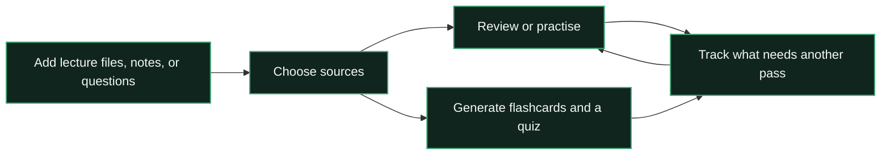

# Recall Loop

**Turn your course materials into a study session you can actually use.**

Recall Loop keeps lecture files, notes, and class questions together by subject. Pick the sources you want to study, then review the original material, practise questions, or build a set of flashcards and quiz questions from it.

## Your study loop

## What it does

- **Organizes by subject:** Keep each class and its materials in one folder.
- **Previews lectures:** View PDF pages and PowerPoint slides in their original layout. Extracted text helps connect study questions with relevant material.
- **Supports focused review:** Work through Cram, Steady, or Deep sessions and revisit questions you missed or marked uncertain.
- **Builds AI study sets:** Generate a concise report, source-based flashcards, and multiple-choice quiz questions. Existing class questions can guide what the set covers.
- **Exports for other study tools:** Download flashcards or quiz questions as CSV files.
- **Keeps your workspace on this browser:** Your folders and progress stay in this browser. Download a backup to move them elsewhere.

## Materials you can add

PDF, PPT/PPTX, DOCX, TXT, Markdown, pasted notes, and questions. Recall Loop extracts text from supported files; scanned PDFs may need OCR before their text can be used for matching or AI study sets. PDF pages and slides can still be previewed in the app.

## Using AI

AI features are optional. Connect your own Gemini or OpenAI API key, select the sources, and choose what to generate. The key is held in the current tab’s memory and is cleared when the tab is refreshed or closed. When you generate, the selected extracted study text and key are sent from your browser to the provider you chose. Review generated material and its source evidence before relying on it.

## Your workspace

Recall Loop is designed for individual study in a browser. Materials, folders, and progress are saved in that browser and do not automatically sync to another device. Use the workspace backup in Progress when you need to move or keep a copy of your work.
