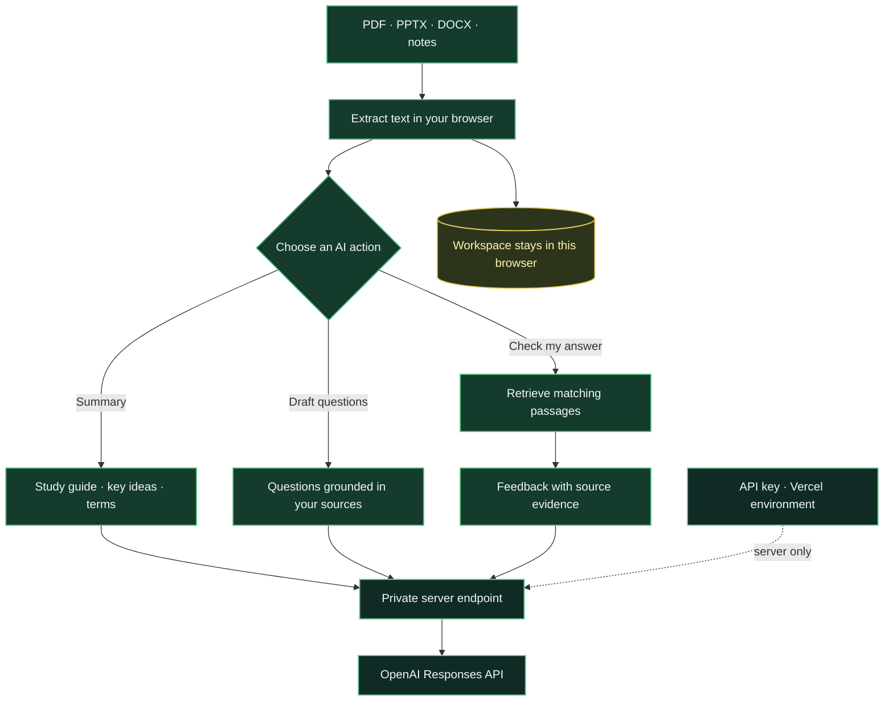

# Recall Loop

**A focused study workspace that turns your own course materials into a repeatable recall loop.** Organize by subject, connect questions to source evidence, study from memory, then review what needs another pass.

[](https://github.com/jaexmachine/recall-loop)
[](https://recall-loop-self.vercel.app)
[](https://expo.dev/)
[](https://vercel.com/)

**[Open Recall Loop](https://recall-loop-self.vercel.app)** · **[View the source](https://github.com/jaexmachine/recall-loop)**

---

## The study loop


## What you can do

| Area | Features |
| --- | --- |
| **Organize** | Create subject folders and keep notes, questions, and lecture files together. |
| **Preview** | View original PDF pages and PowerPoint slides. Question-linked terms are highlighted over the page without changing its layout. |
| **Study** | Choose Cram, Steady, or Deep; select one file, notes, or the whole subject as the study baseline. |
| **Review** | Use AI to draft questions, summarize a subject, and check a typed answer against relevant source passages. |
| **Track** | Save attempts and progress in the current browser. Export or restore a private workspace backup. |

### Supported files

| File type | What Recall Loop does |
| --- | --- |
| PDF | Extracts selectable text and renders the original page. Scanned pages can be viewed but need OCR for text matching. |
| PPT / PPTX | Extracts slide text and renders the original slide in the browser. |
| DOCX | Extracts document text for matching and study. |
| TXT / Markdown | Reads plain text and Markdown notes. |

## AI study flow



The browser extracts document text and keeps the workspace locally. When you ask for AI help, the relevant extracted text is sent to the Recall Loop API endpoint and then to OpenAI. The API key stays on the server. Requests use `store: false`; OpenAI may still retain API content in abuse-monitoring logs for up to 30 days by default. Do not send confidential course or personal information unless you are comfortable with that handling.

Answer feedback uses a small lexical retrieval step on the server to select up to five relevant passages before asking the model. This is a first grounded prototype, not a vector database or a full RAG pipeline. Generated content can be wrong; check the cited passage before relying on it.

## Run locally

Requirements: Node.js and npm.

```bash
git clone https://github.com/jaexmachine/recall-loop.git
cd recall-loop
npm install
```

Copy `.env.example` to `.env` and replace the placeholder with your API key. In PowerShell, run `Copy-Item .env.example .env`, then edit `.env`.

Run the AI endpoint in one terminal:

```bash
npm run ai:local
```

Run the website in a second terminal:

```bash
npm run web -- --port 8081
```

The local AI endpoint listens on `127.0.0.1:3001`. If no key is configured, AI actions show a setup message. Keep `.env` private; it is ignored by Git.

Create a production web build:

```bash
npm run build:web
```

The static site is exported to `dist/`.

## Deploy on Vercel

The repository includes Vercel settings for the Expo web export.

1. Import `jaexmachine/recall-loop` into Vercel.
2. Use the repository root and the `main` branch.
3. Deploy with the detected project settings.

The build runs `npm run build:web` and serves `dist/`. The `/api/ai` function runs separately on Vercel’s Node.js runtime. Each push to `main` triggers a production deployment; pull requests receive preview deployments.

Add `OPENAI_API_KEY` in **Vercel → Project Settings → Environment Variables** for Production, Preview, and Development, then redeploy. Optionally set `OPENAI_MODEL`; the default is `gpt-6-luna`. Never add the key to `App.tsx`, a public `EXPO_PUBLIC_*` variable, or Git. The app has no account system yet, so visitors share the configured API usage. The endpoint applies request size limits and a basic rate guard; also set a usage budget or spending alert on the OpenAI project used for this site.

## Current stage

Recall Loop 0.1 is a browser-based prototype with optional OpenAI features. AI summaries and question drafts use the supplied folder or selected study sources. Answer feedback retrieves relevant source passages and returns an evidence quote; it is a study aid, not an automatic grade. Local question-to-source matching remains available as a transparent fallback.

Some complex PowerPoint features may render differently from Microsoft Office. Large files are limited to keep browser storage usable: uploads are capped at 20 MB, with an additional limit on extracted text. Browser data does not automatically transfer between devices; use a backup when moving your workspace.

Register is currently a visual placeholder. Native Android file picking and account-based sync are not included.
