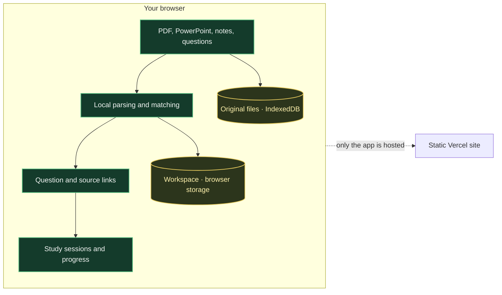

# Recall Loop

**A focused study workspace that turns your own course materials into a repeatable recall loop.** Organize by subject, connect questions to source evidence, study from memory, then review what needs another pass.

[](https://github.com/jaexmachine/recall-loop)
[](https://recall-loop-self.vercel.app)
[](https://expo.dev/)
[](https://vercel.com/)

**[Open Recall Loop](https://recall-loop-self.vercel.app)** · **[View the source](https://github.com/jaexmachine/recall-loop)**

---

## The study loop


## What you can do

| Area | Features |
| --- | --- |
| **Organize** | Create subject folders and keep notes, questions, and lecture files together. |
| **Preview** | View original PDF pages and PowerPoint slides. Question-linked terms are highlighted over the page without changing its layout. |
| **Study** | Choose Cram, Steady, or Deep; select one file, notes, or the whole subject as the study baseline. |
| **Review** | Match questions to likely source passages, inspect suggestions, and adjust links before relying on them. |
| **Track** | Save attempts and progress in the current browser. Export or restore a private workspace backup. |

### Supported files

| File type | What Recall Loop does |
| --- | --- |
| PDF | Extracts selectable text and renders the original page. Scanned pages can be viewed but need OCR for text matching. |
| PPT / PPTX | Extracts slide text and renders the original slide in the browser. |
| DOCX | Extracts document text for matching and study. |
| TXT / Markdown | Reads plain text and Markdown notes. |

## How your materials are handled



Recall Loop has no account system or cloud sync yet. The deployed site serves the app; uploaded documents and workspace data are processed and stored in the browser.

## Run locally

Requirements: Node.js and npm.

```bash
git clone https://github.com/jaexmachine/recall-loop.git
cd recall-loop
npm install
npm run web
```

Create a production web build:

```bash
npm run build:web
```

The static site is exported to `dist/`.

## Deploy on Vercel

The repository includes Vercel settings for the Expo web export.

1. Import `jaexmachine/recall-loop` into Vercel.
2. Use the repository root and the `main` branch.
3. Deploy with the detected project settings.

The build runs `npm run build:web` and serves `dist/`. Each push to `main` triggers a production deployment; pull requests receive preview deployments.

## Current stage

Recall Loop 0.1 is a browser-based prototype. Question matching and question drafting use transparent local heuristics, not an AI model or RAG system. Treat suggested links as starting points and verify the source evidence. Custom answers are not automatically graded.

Some complex PowerPoint features may render differently from Microsoft Office. Large files are limited to keep browser storage usable: uploads are capped at 20 MB, with an additional limit on extracted text. Browser data does not automatically transfer between devices; use a backup when moving your workspace.

Register is currently a visual placeholder. Native Android file picking and account-based sync are not included.
